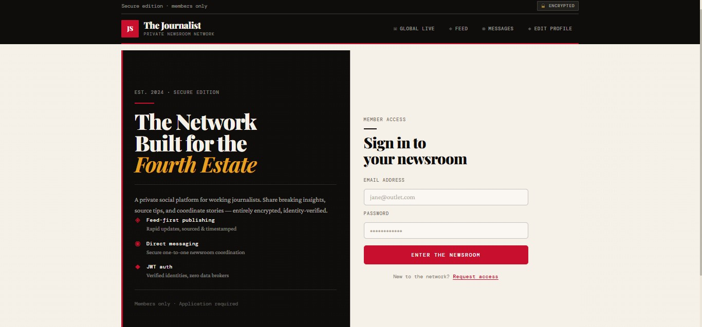
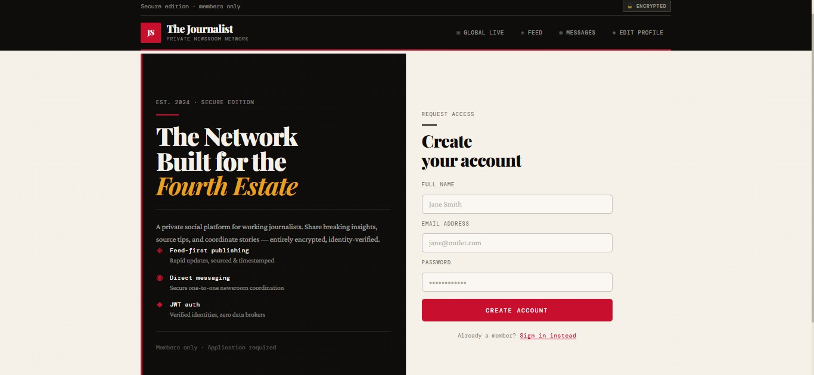
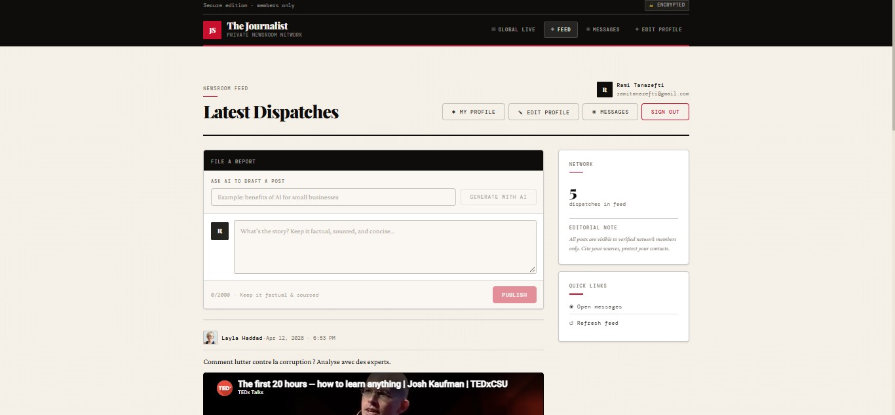
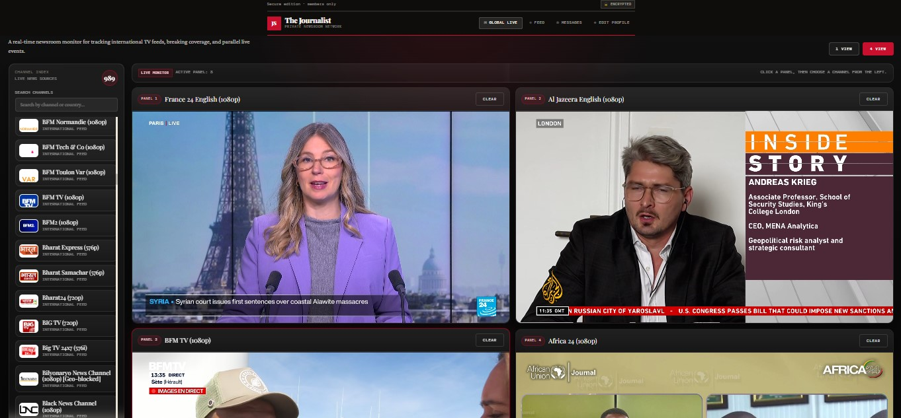
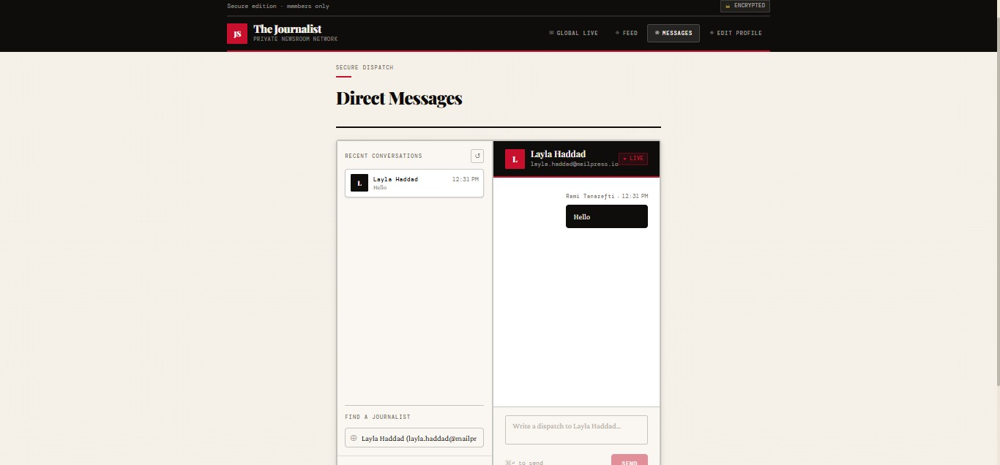

# 📰 NewsroomOS

> **Centralized digital workspace for modern journalists — monitor, collaborate, analyze, publish and follow live information from one platform.**

**NewsroomOS** is a full-stack web platform designed as a **centralized workspace for journalists and editorial teams**.

The main objective of NewsroomOS is to reduce the fragmentation of tools used daily in a newsroom by bringing together several essential features in a single interface.

The platform notably allows users to:

- 📰 view and manage journalistic content;
- 📺 monitor multiple streams through a **TV Wall**;
- 🤖 use artificial intelligence-based tools;
- ✍️ create and manage posts;
- 💬 communicate with other newsroom members;
- 👤 manage users and their profiles;
- 🌍 follow live content and information;
- 🔐 secure access to the different features;
- ⚡ centralize the tools needed for journalistic work.

NewsroomOS is therefore designed as a true **Newsroom Operating Workspace**: a unified environment enabling journalists to monitor information, collaborate, analyze content, and work more efficiently.

The project is based on an architecture that clearly separates:

- **Angular** for the frontend;
- **Node.js / Express** for the backend;
- **MongoDB / Mongoose** for the database;
- **JWT / bcrypt** for authentication and security;
- **GitHub Actions** for continuous integration;
- **AI features** integrated into the workspace.

---

# 📸 Application Overview

## 🔐 Login

<p align="center">
  
</p>

The login screen allows authorized users to securely access their NewsroomOS environment.

Authentication relies on a JWT token system used to secure communications between the Angular frontend and the backend API.

---

## ✍️ Signup

<p align="center">
  
</p>

The signup interface allows new users to create an account to access the features available on the platform.

---

## 📰 News Feed

<p align="center">
  
</p>

The **News Feed** is one of the central areas of NewsroomOS.

It allows users to view available posts and centralize journalistic content directly in the workspace.

---

## 📺 TV Wall

<p align="center">
  
</p>

The **TV Wall** allows multiple video content sources or streams to be followed from a centralized interface.

This feature is particularly suited to a newsroom where multiple information sources must be monitored simultaneously.

The TV Wall helps turn NewsroomOS into a true **journalistic monitoring center**.

---

## 💬 Messages

<p align="center">
  
</p>

Internal messaging allows users to communicate directly from NewsroomOS without leaving their work environment.

---

# 🎯 NewsroomOS Concept

NewsroomOS is designed as a centralized system bringing together several components of a modern newsroom.

```text
                             ┌─────────────────────────────┐
                             │         NewsroomOS          │
                             │                             │
                             │ Centralized Newsroom Hub    │
                             └──────────────┬──────────────┘
                                            │
             ┌──────────────────────────────┼──────────────────────────────┐
             │                              │                              │
             ▼                              ▼                              ▼
      ┌──────────────┐              ┌──────────────┐               ┌──────────────┐
      │  📰 News     │              │  📺 TV Wall │               │   🤖 AI      │
      │     Feed     │              │              │               │  Workspace   │
      └──────┬───────┘              └──────┬───────┘               └──────┬───────┘
             │                              │                              │
             └──────────────────────┬───────┴──────────────┬───────────────┘
                                    │                      │
                                    ▼                      ▼
                              ┌──────────────┐       ┌──────────────┐
                              │ 💬 Messaging │       │ ✍️ Publishing│
                              └──────┬───────┘       └──────┬───────┘
                                     │                      │
                                     └──────────┬───────────┘
                                                │
                                                ▼
                                      ┌──────────────────┐
                                      │ 👤 User Workspace │
                                      └──────────────────┘
```

The idea is to offer an environment in which a journalist can stay connected to their main sources, monitor news, use AI tools, communicate with their team, and manage their content from a single application.

---

# ✨ Features

## 🔐 Authentication & Security

- User registration
- Secure login
- JWT-based authentication
- Password hashing with bcrypt
- Backend route protection
- Authentication middleware
- Frontend token management
- Angular Route Guards
- Angular HTTP Interceptor
- Environment variables for sensitive data
- Exclusion of the `.env` file from the repository

---

## 📰 News Feed & Posts

- Creating posts
- Viewing posts
- Managing journalistic content
- Centralized news feed
- Interacting with content
- Managing data through the REST API

---

## 📺 TV Wall

The **TV Wall** centralizes the monitoring of live content.

It is one of the main elements of NewsroomOS and brings **live monitoring** into the journalist’s workspace.

### Objectives

- Centralize multiple streams
- Reduce the need to use multiple windows
- Make live content monitoring easier
- Provide an overall view from a single dashboard
- Improve the responsiveness of an editorial team

---

## 🤖 Artificial Intelligence

NewsroomOS also integrates artificial intelligence-based features to assist journalistic work.

Depending on the features available in the workspace, AI can be used to support various tasks such as:

- content analysis;
- text summarization;
- writing assistance;
- rephrasing;
- information extraction;
- content processing;
- research assistance;
- rapid information organization.

The goal is not to replace journalists, but to offer tools that can accelerate certain repetitive or analytical tasks.

---

## 💬 Messaging

- Communication between users
- Message management
- Dedicated REST API
- Protected routes
- Integration directly into the workspace

---

## 👤 User Management

- Viewing the user profile
- Editing information
- Profile management
- Protection of routes requiring authentication
- Identification of logged-in users

---

## 🌍 Live / News

- Dedicated interface for live content
- Centralization of information
- Integration with the NewsroomOS environment
- Navigation from the main workspace

---

# 🏗️ Architecture

NewsroomOS uses a **Frontend / Backend / Database** architecture.

```text
                         ┌──────────────────────┐
                         │         User         │
                         │      Web Browser     │
                         └──────────┬───────────┘
                                    │
                               HTTP / HTTPS
                                    │
                                    ▼
                    ┌─────────────────────────────┐
                    │          Angular            │
                    │          Frontend           │
                    │                             │
                    │ • Components                │
                    │ • Pages                     │
                    │ • Services                  │
                    │ • Guards                    │
                    │ • HTTP Interceptors         │
                    │ • News Feed                 │
                    │ • TV Wall                   │
                    │ • AI Workspace              │
                    └──────────────┬──────────────┘
                                   │
                                REST API
                                   │
                                   ▼
                    ┌─────────────────────────────┐
                    │      Node.js / Express      │
                    │           Backend           │
                    │                             │
                    │ • Routes                    │
                    │ • Middleware                │
                    │ • Authentication            │
                    │ • Business Logic            │
                    │ • API Services              │
                    └──────────────┬──────────────┘
                                   │
                                Mongoose
                                   │
                                   ▼
                    ┌─────────────────────────────┐
                    │           MongoDB           │
                    │                             │
                    │ • Users                     │
                    │ • Posts                     │
                    │ • Messages                  │
                    └─────────────────────────────┘
```

---

# 📁 Project Structure

```text
NewsroomOS/
│
│
├── docs/
│   └── screenshots/
│       ├── login.png
│       ├── signup.png
│       ├── feed.png
│       ├── live-tv.png
│       └── messages.png
│
├── backend/
│   ├── package.json
│   ├── package-lock.json
│   ├── print.py
│   │
│   └── src/
│       ├── config/
│       │   └── db.js
│       │
│       ├── middleware/
│       │   └── auth.middleware.js
│       │
│       ├── models/
│       │   ├── Message.js
│       │   ├── Post.js
│       │   └── User.js
│       │
│       ├── routes/
│       │   ├── auth.routes.js
│       │   ├── message.routes.js
│       │   ├── post.routes.js
│       │   └── user.routes.js
│       │
│       └── server.js
│
├── frontend/
│   └── journalist-frontend/
│       ├── public/
│       │
│       ├── src/
│       │   └── app/
│       │       ├── guards/
│       │       ├── interceptors/
│       │       ├── pages/
│       │       └── services/
│       │
│       ├── angular.json
│       ├── package.json
│       ├── package-lock.json
│       ├── tsconfig.json
│       ├── tsconfig.app.json
│       └── tsconfig.spec.json
├── .github/
│   └── workflows/
│       └── ci.yml
│
├── .gitignore
└── README.md
```

---

# 🛠️ Tech Stack

## Frontend

- **Angular**
- **TypeScript**
- HTML5
- SCSS
- Angular Router
- Angular Services
- Angular HTTP Client
- Angular Route Guards
- HTTP Interceptors

---

## Backend

- **Node.js**
- **Express.js**
- JavaScript
- REST API
- JWT
- bcrypt
- dotenv

---

## Database

- **MongoDB**
- **Mongoose**

---

## DevOps & Version Control

- **Git**
- **GitHub**
- **GitHub Actions**
- npm
- Continuous Integration

---

# 🔄 General Workflow

The main operation of NewsroomOS follows this flow:

```text
User
    │
    ▼
NewsroomOS Frontend
    │
    │ HTTP Request
    ▼
Angular Services
    │
    ▼
Express REST API
    │
    ├── Authentication
    │
    ├── Users
    │
    ├── Posts
    │
    ├── Messages
    │
    └── Services
    │
    ▼
MongoDB
    │
    ▼
Response
    │
    ▼
Angular Frontend
    │
    ▼
NewsroomOS Interface
    │
    ▼
User
```

---

# 🔑 Authentication

When a user logs in, the authentication system follows this process:

```text
User
    │
    ▼
Login Form
    │
    ▼
Angular
    │
    │ POST /auth/login
    ▼
Express API
    │
    ▼
Credential verification
    │
    ▼
bcrypt
    │
    ▼
JWT generated
    │
    ▼
Angular receives the token
    │
    ▼
Token storage / management
    │
    ▼
HTTP Interceptor
    │
    ▼
Authorization: Bearer <token>
    │
    ▼
Middleware Auth
    │
    ▼
Protected route
```

The authentication middleware verifies the JWT before allowing access to protected resources.

---

# 🔐 Security

Security relies on several mechanisms.

## Password Management

Passwords are not stored directly.

They are hashed using:

```text
bcrypt
```

---

## JSON Web Token

After successful authentication, the backend generates a JWT token.

The token is then used for requests to protected routes.

```text
Client
  │
  │ Authorization: Bearer JWT
  ▼
Express Middleware
  │
  ├── Valid token
  │       │
  │       ▼
  │   Authorized route
  │
  └── Invalid token
          │
          ▼
      Access denied
```

---

# 🌱 Environment Variables

Sensitive information is stored in a `.env` file.

Example:

```env
PORT=5000
MONGO_URI=your_mongodb_connection_string
JWT_SECRET=your_secure_jwt_secret
```

The `.env` file must never be added to the repository.

Example `.gitignore`:

```gitignore
# Dependencies
node_modules/

# Environment
.env
.env.*

# Angular
.angular/
dist/

# Logs
*.log

# OS
.DS_Store
Thumbs.db
```

> ⚠️ The real values of `MONGO_URI`, `JWT_SECRET`, API keys, and other secrets must remain private.

---

# 📡 REST API

The backend exposes several groups of REST routes.

| Domain | Route | Description |
|---|---|---|
| Authentication | `/auth/*` | Registration and login |
| Users | `/users/*` | User management |
| Posts | `/posts/*` | Post management |
| Messages | `/messages/*` | Message management |

Endpoints may evolve as NewsroomOS is developed.

---

# 🔄 Continuous Integration — CI

NewsroomOS uses **GitHub Actions** to automate project checks.

The CI workflow runs automatically on events configured in the repository.

```text
Developer
    │
    │ git push
    ▼
GitHub Repository
    │
    ▼
GitHub Actions
    │
    ├── Checkout repository
    │
    ├── Setup Node.js
    │
    ├── Install dependencies
    │
    ├── Run checks
    │
    ├── Run tests
    │
    └── Build project
    │
    ▼
CI Validation
```

## CI Objectives

- Automate checks
- Verify dependency installation
- Detect errors quickly
- Run available tests
- Verify that the frontend can be built
- Reduce errors before integration
- Improve project quality

---

# 🧪 Tests

The Angular frontend includes a dedicated testing configuration.

To run tests:

```bash
npm test
```
or:
or:

```bash
ng test
```

Tests can also be run automatically through GitHub Actions.

---

# 🚀 Installation

## Prerequisites

Install the following tools:

- Node.js
- npm
- MongoDB
- Git
- Angular CLI if needed

Check versions:

```bash
node --version
npm --version
git --version
```

---

# 📥 Clone NewsroomOS

```bash
git clone https://github.com/NameRami/NewsroomOS.git
```

Then:

```bash
cd NewsroomOS
```

---

# ⚙️ Backend Setup

Go to the backend folder:

```bash
cd backend
```

Install dependencies:

```bash
npm install
```

Create a file:

```text
.env
```

Add:

```env
PORT=5000
MONGO_URI=your_mongodb_connection_string
JWT_SECRET=your_secure_jwt_secret
```

Start the backend:

```bash
npm start
```

Server:

```text
http://localhost:5000
```

---

# 💻 Frontend Setup

In another terminal:

```bash
cd frontend/journalist-frontend
```

Install dependencies:

```bash
npm install
```

Start Angular:

```bash
npm start
```

or:

```bash
ng serve
```

Frontend:

```text
http://localhost:4200
```

---

# 🔄 Request Lifecycle

```text
┌───────────────┐
│     User      │
└───────┬───────┘
        │
        ▼
┌───────────────┐
│ Angular Page  │
└───────┬───────┘
        │
        ▼
┌───────────────┐
│ Angular       │
│ Service       │
└───────┬───────┘
        │ HTTP
        ▼
┌───────────────┐
│ Express Route │
└───────┬───────┘
        │
        ▼
┌───────────────┐
│ Middleware    │
└───────┬───────┘
        │
        ▼
┌───────────────┐
│ Business      │
│ Logic         │
└───────┬───────┘
        │
        ▼
┌───────────────┐
│   Mongoose    │
└───────┬───────┘
        │
        ▼
┌───────────────┐
│    MongoDB    │
└───────┬───────┘
        │
        ▼
     Response
```

---

# 🧠 Role of AI

Artificial intelligence is an important extension of the NewsroomOS concept.

```text
                      ┌──────────────────────┐
                      │     Journalist       │
                      └──────────┬───────────┘
                                 │
                                 ▼
                     ┌─────────────────────────┐
                     │       NewsroomOS        │
                     └────────────┬────────────┘
                                  │
             ┌────────────────────┼────────────────────┐
             │                    │                    │
             ▼                    ▼                    ▼
        News Content          AI Tools             Live Data
             │                    │                    │
             │             ┌──────┴──────┐             │
             │             │             │             │
             ▼             ▼             ▼             ▼
        Monitoring      Analysis       Assist.      TV Wall
                           │           Writing
                           │
                           ▼
                      Journalist
                      Decision
```

AI acts as an assistance layer integrated into the workspace, while final validation and editorial decisions remain under the journalist’s control.

---

# 📊 Project Status

| Feature | Status |
|---|---|
| Frontend/backend architecture | ✅ |
| Angular | ✅ |
| Node.js / Express | ✅ |
| MongoDB / Mongoose | ✅ |
| Authentication | ✅ |
| JWT | ✅ |
| bcrypt | ✅ |
| User management | ✅ |
| Posts | ✅ |
| News Feed | ✅ |
| Messaging | ✅ |
| User profile | ✅ |
| TV Wall | ✅ |
| AI features | ✅ |
| Angular Guards | ✅ |
| HTTP Interceptors | ✅ |
| Environment variables | ✅ |
| Git / GitHub | ✅ |
| GitHub Actions | ✅ |
| Continuous Integration | ✅ |
| Advanced tests | 🚧 |
| Complete API documentation | 🚧 |
| Docker | 🚧 |
| Docker Compose | 🚧 |
| Continuous Deployment | 🚧 |
| Production deployment | 🚧 |
| Monitoring | 🚧 |
| Structured logs | 🚧 |

---

# 🗺️ Roadmap

## Phase 1 — Core Platform

- [x] Frontend/backend architecture
- [x] Angular
- [x] Express API
- [x] MongoDB
- [x] Authentication
- [x] User management
- [x] Posts
- [x] Messaging
- [x] User profiles

---

## Phase 2 — Newsroom Workspace

- [x] News Feed
- [x] Live interface
- [x] TV Wall
- [x] Tool centralization
- [x] Integrated messaging
- [x] User workspace

---

## Phase 3 — Artificial Intelligence

- [x] Integration of AI features
- [x] Assistance integrated into the workspace
- [ ] Enhancement of analysis tools
- [ ] Advanced automatic summarization
- [ ] Intelligent information extraction
- [ ] Automatic content classification
- [ ] AI-assisted research

---

## Phase 4 — Quality & CI

- [x] Git
- [x] GitHub
- [x] GitHub Actions
- [x] Pipeline CI
- [x] Automated checks
- [ ] Increased test coverage
- [ ] Automated quality analysis
- [ ] Additional backend tests

---

## Phase 5 — Containerization

- [ ] Docker backend
- [ ] Docker frontend
- [ ] Docker Compose
- [ ] Image optimization
- [ ] Reproducible environment

---

## Phase 6 — Deployment

- [ ] Continuous Deployment
- [ ] VPS / Cloud deployment
- [ ] Staging environment
- [ ] Production environment
- [ ] Centralized secrets management

---

## Phase 7 — Observability

- [ ] Structured logs
- [ ] Monitoring
- [ ] Metrics
- [ ] Dashboards
- [ ] Alerting

---

# 🎯 DevOps Vision

The long-term objective is to transform NewsroomOS into a platform with a complete DevOps pipeline.

```text
                ┌──────────────┐
                │     Git      │
                └──────┬───────┘
                       │
                       ▼
                ┌──────────────┐
                │    GitHub    │
                └──────┬───────┘
                       │
                       ▼
             ┌───────────────────┐
             │   GitHub Actions  │
             │        CI         │
             └─────────┬─────────┘
                       │
                       ▼
                ┌──────────────┐
                │     Tests    │
                └──────┬───────┘
                       │
                       ▼
                 ┌─────────────┐
                 │    Build    │
                 └──────┬──────┘
                        │
                        ▼
                  [ Coming soon ]
                        │
               ┌────────┴────────┐
               ▼                 ▼
            Docker              CD
               │                 │
               └────────┬────────┘
                        ▼
                  Deployment
                        │
                        ▼
                   Monitoring
```

### Current Status

```text
Git
 │
 ▼
GitHub
 │
 ▼
GitHub Actions
 │
 ▼
Continuous Integration
 │
 ▼
Build / Verification
 │
 ▼
✅ Current DevOps Stage


Docker
 │
 ▼
Continuous Deployment
 │
 ▼
Production
 │
 ▼
Monitoring
 │
 ▼
🚧 Next Stages
```

---

# 🌐 Overall Vision of NewsroomOS

```text
                               NEWSROOMOS
                                   │
             ┌─────────────────────┼─────────────────────┐
             │                     │                     │
             ▼                     ▼                     ▼
        INFORMATION           COLLABORATION          PRODUCTIVITY
             │                     │                     │
      ┌──────┴──────┐        ┌─────┴─────┐         ┌─────┴─────┐
      │             │        │           │         │           │
      ▼             ▼        ▼           ▼         ▼           ▼
 News Feed       TV Wall   Messages    Users       AI       Publishing
      │             │        │           │         │           │
      └─────────────┴────────┴─────┬─────┴─────────┴───────────┘
                                   │
                                   ▼
                         ┌──────────────────┐
                         │ Journalist Desk  │
                         │ Unified Workspace│
                         └──────────────────┘
```

The vision of NewsroomOS is to provide a single interface bringing together the essential tools for the daily operation of a modern digital newsroom.

---

# 🤝 Contributing

To contribute to the project:

1. Fork the repository
2. Create a branch
3. Make changes
4. Add or update tests
5. Commit the changes
6. Push the branch
7. Create a Pull Request

Create a branch:

```bash
git checkout -b feature/new-feature
```

Commit:

```bash
git add .
git commit -m "feat: add new feature"
```

Push:

```bash
git push origin feature/new-feature
```

---

# 👨‍💻 Author

**Rami Tanazefti**

Computer Engineering Student — **DevOps & MLOps**

🇹🇳 Tunisia

### GitHub

```text
https://github.com/NameRami
```

### Repository

```text
https://github.com/NameRami/NewsroomOS
```

---

# 📄 License

NewsroomOS is currently developed in an **academic, experimental, and demonstration** context.

An open-source license may be added later as the project evolves.

---

# 📰 NewsroomOS

**Monitor. Analyze. Collaborate. Publish.**

> One workspace for the modern newsroom.
